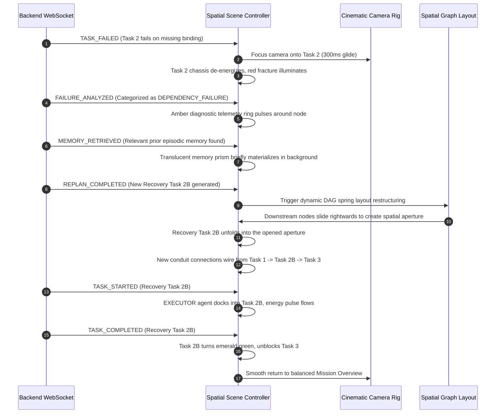

# Agentic OS — Spatial Mission Workspace Design Specification

**Document Version**: 1.0  
**Target Milestone**: Spatial Volumetric DAG Environment (`/missions/[id]`)  
**Status**: Proposal for Review  

---

## 1. Executive Summary & Design Vision

### 1.1 Product Identity & Core Principle
**Agentic OS** is an autonomous multi-agent operating system and mission command center.  
The existing UI identity (deep obsidian `#09090b` palette, left navigation sidebar, top Raycast-style command bar, mission metrics, approval workflows, and task execution inspection) remains the authoritative foundation of the application.

3D spatial visualization **augments** the product without replacing its functional identity or imposing an unrelated metaphor.

```
┌────────────────────────────────────────────────────────────────────────┐
│                        AGENTIC OS APPLICATION                          │
│                                                                        │
│  ┌───────────┐  ┌───────────────────────────────────────────────────┐  │
│  │           │  │ TopNav: Global Command Bar • Fleet Status • 3D    │  │
│  │  Sidebar  │  ├───────────────────────────────────────────────────┤  │
│  │           │  │ Mission Header • Status • Progress • [2D] / [3D]  │  │
│  │  • Home   │  ├───────────────────────────────────────────────────┤  │
│  │  • Miss.  │  │                                                   │  │
│  │  • Tasks  │  │        SPATIAL COMPUTATIONAL ENVIRONMENT          │  │
│  │  • Appr.  │  │        (Volumetric Task DAG • Conduits            │  │
│  │  • Agents │  │         Geometric Agents • Live State)            │  │
│  │  • Memory │  │                                                   │  │
│  │  • Tools  │  ├───────────────────────────────────────────────────┤  │
│  │  • Activ. │  │ Selected Node Inspection & Live Log Telemetry     │  │
│  └───────────┘  └───────────────────────────────────────────────────┘  │
└────────────────────────────────────────────────────────────────────────┘
```

### 1.2 Visual Language & Metaphor
- **Design Metaphor**: **Abstract Computational Architecture + Spatial Data Visualization + High-End Experimental WebGL + Mission Control**.
- **Not**: Railway tracks, miniature train sets, beige industrial desks, toy semaphores, or generic cyan/purple glowing spheres connected by lines.
- **Physicality**: Floating modular compute blocks, suspended architectural slabs, smoked glass panels, machined titanium edges, layered volumetric conduits, and depth-of-field spatial hierarchy.
- **Color Palette**:
  - Base: Deep Graphite (`#0E0E12`), Obsidian (`#060608`), Smoked Translucent Glass (`rgba(18, 18, 24, 0.75)`), Soft Silver / Machined Aluminium (`#A0A0AA`).
  - Restrained Primary Accent: Electric Cyan-Slate (`#38BDF8` / `#22D3EE`).
  - State Indicators (Used sparingly & meaningfully):
    - `RUNNING`: Focused Warm Amber / Gold Pulse (`#F59E0B`).
    - `WAITING_APPROVAL`: Amber Prismatic Hold Shutter (`#D97706`).
    - `FAILED`: De-energized Structure + Crimson Stress Fracture (`#EF4444`).
    - `COMPLETED`: Settled Graphite-Aluminium with Subtle Emerald Glow (`#10B981`).
    - `RECOVERY`: Luminous High-Precision Auxiliary Sub-module (`#06B6D4`).

---

## 2. Spatial Scene Hierarchy & Depth Composition

The 3D environment inside `/missions/[id]` is organized across three deliberate spatial depth planes:

```
                  Z-AXIS DEPTH HIERARCHY
               
  [ BACKGROUND: Z = -40 to -80 ]
  ├── Episodic Memory Nodes (Subtle floating faceted crystals)
  ├── Distant Computational Grid Matrix
  └── Faded Inactive DAG Branches (Atmospheric Occlusion)
  
  [ MIDGROUND: Z = 0 to -20 (ACTIVE EXECUTION PLANE) ]
  ├── Volumetric Task Compute Slabs (Layered glass/alloy blocks)
  ├── Structural Data Conduits & Energy Pulse Tracks
  ├── Attached Geometric Agent Cores
  └── Active Dependency Junction Locks
  
  [ FOREGROUND: Z = +15 to +30 ]
  ├── Geometric Framing Pillars (Edge of Viewport Vignette)
  └── Camera Trajectory Corridor for Intimate Node Focus
```

---

## 3. Spatial Component Visual Design

### 3.1 Task Compute Module (`TaskBlock3D`)
Each task node in the mission DAG is rendered as a precision architectural compute slab:
- **Base Sub-chassis**: Machined dark graphite alloy box with beveled edges and corner mounting fasteners.
- **Top Layer**: Smoked semi-translucent glass plate (`roughness: 0.1, transmission: 0.85`) with crisp monospace typographic texturing:
  - Task Index (`01`, `02`, `03`).
  - Compact Title (up to 28 chars).
  - Assigned Agent Tag (`[PLANNER]`, `[CODER]`, `[RESEARCHER]`).
  - Discrete Status Badge (`READY`, `RUNNING`, `FAILED`, `COMPLETED`).
- **Input / Output Bus Ports**: Precision terminal contact pins on left (intake) and right (exhaust) that anchor incoming/outgoing structural conduits.
- **Active State Module**:
  - `RUNNING`: Internal amber energy core illuminates; subtle micro-rotary actuator spins.
  - `WAITING_APPROVAL`: A physical translucent amber security shutter locks over the intake port.
  - `FAILED`: The chassis tilts slightly off-axis (`rotation.z = 0.08`), conduits de-energize, and an internal red warning indicator trips.
  - `RECOVERY`: A secondary auxiliary tier extends from beneath the chassis along polished silver guide rails.

```
 ┌────────────────────────────────────────────────────────┐
 │ [MOD-02 // CODER]                     ● RUNNING        │
 │                                                        │
 │ Synthesize Database Migrations & Models                │
 │                                                        │
 │ ◄── INTAKE BUS                               EXHAUST ──►│
 └────────────────────────────────────────────────────────┘
```

### 3.2 Dependency Conduits (`SpatialConduit3D`)
Dependencies between tasks are not flat wires or bezier curves. They are architectural data pathways:
- **Structure**: Extruded rectangular composite conduits with a frosted optical channel running through the center.
- **Multi-Prerequisite Convergence**: When 2+ tasks feed into one node, the conduits merge into an integrated **Junction Distributor Block** before entering the target task intake.
- **Dynamic Energy Pulse**:
  - During `RUNNING` tasks, discrete packets of light travel along the conduit from source to target.
  - When a task completes, the conduit settles into a steady silver conductivity state.
  - When a dependency is blocked, the conduit rests dark with zero energy draw.

### 3.3 Geometric Agent Cores (`AgentEntity3D`)
Agents are specialized geometric autonomous entities that dynamically travel and attach to the active task they are executing:

| Agent Role | Geometric Form | Visual Signature |
| :--- | :--- | :--- |
| **PLANNER** | Inverted Stepped Tetrahedron | Top compass ring, precise structural decomposition |
| **CODER** | Hexagonal Crystalline Prism | Segmented logic facets, code synthesis emitter |
| **RESEARCHER** | Dual-Ring Gyroscopic Orbit | Outer obsidian gimbal, inner knowledge sensor lens |
| **REVIEWER / AUDITOR** | Caliper Optical Shutter | Monolithic frame with twin inspection lenses |
| **EXECUTOR** | Machined Wedge Monolith | Heavy industrial compute core, high-throughput actuator |

- **Behavior**: When an agent starts a task (`AGENT_RUN_STARTED`), the agent smoothly glides from the mission periphery and docks into the task module's designated agent socket (`250ms` cubic ease).

---

## 4. Camera System & Choreography

### 4.1 Smooth Motion Principles
- **Duration**: Normal interaction focus transitions take **250ms to 450ms**.
- **Interpolation**: Smooth exponential spring damping (`lerp(current, target, 1 - Math.exp(-speed * delta))`).
- **Frameloop**: Strictly **`frameloop="demand"`**. The render loop invalidates frames during transitions and sleeps at **0 RAF frame drain** once settled within `< 0.005` distance threshold.

### 4.2 Camera Waypoints & Presets
- **Graph Overview (`FIT_ALL`)**: Orbit camera positioned at high-angle 3/4 elevation (`pitch: 38°`, `yaw: -8°`, `distance: auto-scaled to DAG bounds`).
- **Node Focus (`INSPECT_NODE`)**: Intimate low-angle swoop (`pitch: 24°`, `distance: 22`, target centered on task intake).
- **Failure Focus (`EMERGENCY_FOCUS`)**: Direct head-on zoom onto failed node with dramatic depth-of-field shift.

---

## 5. Signature Replan Choreography (Real WebSocket Events)

The hallmark experience of Agentic OS is observing autonomous self-healing graph replanning in real-time without fake timers:



---

## 6. 2D / 3D Integration on `/missions/[id]`

Inside `/missions/[id]/page.tsx`:
1. **Header Toolbar Switcher**:
   - `[ 2D DAG ]` / `[ SPATIAL VIEW ]` tabs placed directly alongside the Mission Title and status badges.
2. **Shared State Contract**:
   - Selecting a node in 3D opens the standard bottom/side **Task Inspection Drawer** (with full terminal logs, payload inspector, input/output artifacts, and retry controls).
   - Selecting a node in the 2D task list smoothly refocuses the 3D camera to that node when toggled to 3D.
3. **Graceful Fallbacks**:
   - Mobile / low-power devices automatically default to `2D DAG`.
   - `prefers-reduced-motion` skips camera travel animations and uses instantaneous position cuts.

---

## 7. File Structure & Implementation Plan

### 7.1 Reusable Infrastructure to Keep
- `frontend/src/world/adapter/types.ts` — Data models and event contracts.
- `frontend/src/world/adapter/reconcile.ts` — State transformation pipeline.
- `frontend/src/world/adapter/diff.ts` — Scene delta diffing.
- `frontend/src/world/adapter/events.ts` — WebSocket event parser.
- `frontend/src/world/layout/layoutEngine.ts` — ELK DAG layout with position stabilization.

### 7.2 Files to Decommission (Remain Unused in Repository)
- `frontend/src/world/render3d/board/Districts.tsx` (Railway control board)
- `frontend/src/world/render3d/mission/SignalSemaphore3D.tsx` (Railway signal mast)
- `frontend/src/world/render3d/mission/StationPlate3D.tsx` (Railway beige station plate)
- `frontend/src/world/render3d/mission/TrackRoute3D.tsx` (Dual railway steel tracks)
- `frontend/src/world/renderSvg/*` (2D railway SVG diagram)
- `frontend/src/world/ui/DeparturesBoard.tsx` (Airport/train departure flipper)

### 7.3 New Files to Create for Spatial Mission Workspace
```
frontend/src/spatial/
├── SpatialMissionCanvas.tsx        # High-performance Three.js Canvas with demand loop
├── SpatialCameraRig.tsx            # Cinematic smooth spring camera controller
├── SpatialLighting.tsx             # Restrained dark studio lighting & volumetric rim lights
├── components/
│   ├── TaskBlock3D.tsx             # Modular architectural task compute slab
│   ├── SpatialConduit3D.tsx        # Extruded geometric data conduit & energy pulse
│   ├── JunctionDistributor3D.tsx   # Multi-dependency convergence block
│   ├── AgentEntity3D.tsx           # Distinct geometric agent cores
│   ├── MemoryPrism3D.tsx           # Floating episodic memory crystal
│   └── SpatialEnvironment3D.tsx    # Subtle depth grid, framing pillars & atmosphere
├── state/
│   └── useSpatialMissionStore.ts   # UI selection, camera target, and view mode store
└── hooks/
    └── useMissionToSpatialDAG.ts   # Hook bridging Mission/Tasks -> Layout -> 3D Scene
```

---

## 8. Staged Delivery Phases

- **Phase A**: Spatial Mission Workspace Foundation (`SpatialMissionCanvas`, `SpatialCameraRig`, Lighting, and Store).
- **Phase B**: One Real Mission rendered with `TaskBlock3D` compute slabs and `SpatialConduit3D` pathways.
- **Phase C**: Interactive Task Selection, Hover Elevation, and Camera Glide Focus.
- **Phase D**: Real-time State Visualizations (`RUNNING`, `WAITING_APPROVAL`, `COMPLETED`, `FAILED`).
- **Phase E**: Signature Autonomous Replan & Recovery Unfolding Choreography.
- **Phase F**: Compact Coordinated Spatial Core on Home Dashboard.

---

*This document is submitted for review and approval prior to implementation.*
